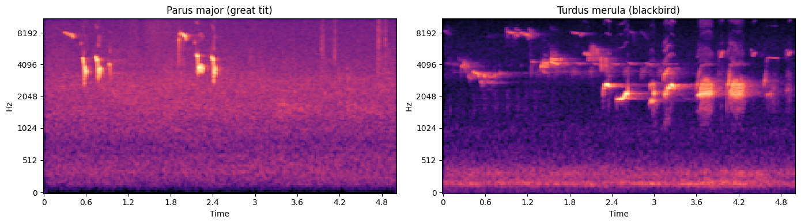
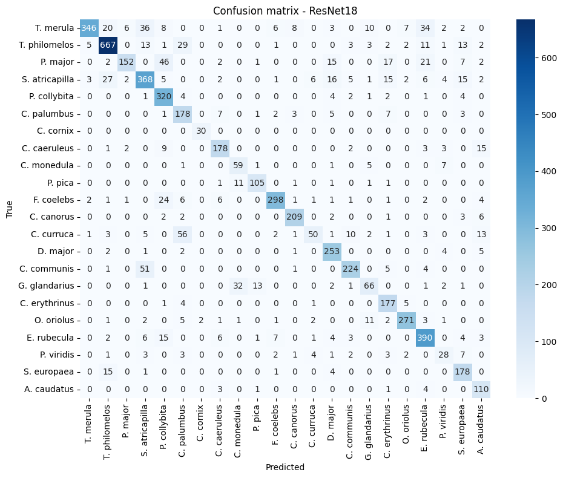

# Bird Song Classifier: Custom CNN vs. Transfer Learning

Classifying 22 Central European bird species from [Xeno-canto](https://xeno-canto.org) recordings with convolutional neural networks on mel-spectrograms. The project compares an ImageNet-pretrained **ResNet18** with two residual CNNs trained from scratch.



## Results

Test set: 258 recordings never seen during training (5,674 five-second windows).

| Model | Parameters | Window accuracy | Window macro F1 | Recording accuracy | Recording macro F1 |
|---|---|---|---|---|---|
| **ResNet18** (ImageNet, fine-tuned) | 11.2M | **0.821** | **0.789** | **0.857** | **0.853** |
| CustomBirdNet (ResNet18 depth, from scratch) | 11.2M | 0.732 | 0.707 | 0.802 | 0.805 |
| CustomBirdNetV2 (smaller, dropout) | 2.8M | 0.759 | 0.722 | 0.802 | 0.800 |

*Window* metrics classify each 5 s clip independently. *Recording* metrics average the predicted probabilities over all windows of a recording.

- Transfer learning clearly outperforms training from scratch.
- Aggregating predictions per recording adds 4–7 percentage points for every model.
- Overfitting is the main limitation: training accuracy reaches 97–99% while validation accuracy stays around 70–80%.
- Most confusions are biologically plausible (jay ↔ jackdaw, common whitethroat ↔ blackcap). A notable exception is the lesser whitethroat being predicted as wood pigeon, probably because of background calls in the recordings.



## Data

- Quality A recordings (topped up with quality B where needed), up to 100 per species, from a bounding box over Central/Eastern Europe (45.9–54.2°N, 11.9–27.0°E).
- 2,154 recordings in total, giving 39,858 spectrogram windows after silence removal.
- Recordings are **not included** in this repository. They are downloaded with the first cell of the notebook (requires a free Xeno-canto API key). Each recording is published under its own Creative Commons licence and belongs to its recordist.

## Method

1. **Preprocessing:** 22,050 Hz → 5 s windows with 50% overlap → silent windows removed (RMS ≤ 0.01) → 128-band mel-spectrogram in dB → min-max normalisation to [0, 1].
2. **Split by recording** (70/15/15, stratified by species, `StratifiedGroupKFold`). Overlapping windows from one recording are nearly identical, so splitting at the window level would leak training data into the test set.
3. **Training:** Adam, class-weighted cross-entropy (to handle class imbalance), early stopping on the validation set (patience 5). The test set is used once, after training.
4. **Models:**
   - **ResNet18:** first convolution reduced to 1 channel by averaging the pretrained RGB filters; new 22-class output layer; learning rate 1e-4.
   - **CustomBirdNet:** the same residual architecture, randomly initialised; learning rate 1e-3.
   - **CustomBirdNetV2:** 3 instead of 4 residual stages, dropout 0.5; learning rate 3e-4.

## Limitations

- Each model was trained once. Repeated runs of the same code differ by several percentage points, so only the advantage of ResNet18 should be considered robust.
- Only ~10–15 test recordings per species, so per-species scores are uncertain.
- Recordings by the same recordist or from the same site may appear in more than one split.

## Running the notebook

```bash
pip install -r requirements.txt
export XC_API_KEY=your_key      # https://xeno-canto.org (account settings)
jupyter notebook bird_song_classifier.ipynb
```

Recordings are saved to `./dataset/<Species_name>/`. A GPU is strongly recommended. Preprocessing keeps all spectrograms in memory (~15 GB RAM at peak).

## Authors

Weronika Czop and Klaudia Zięba. Course project for *Machine Learning for Bioinformatics* (MSc Bioinformatics, Jagiellonian University, 2025/2026).
